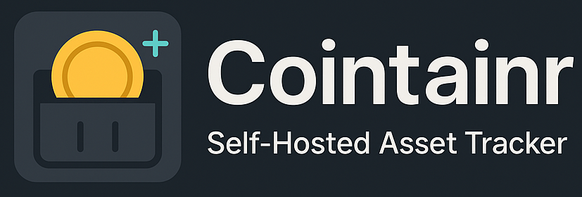

<div align="center">



_A modern, self-hosted portfolio tracking app with a focus on clarity, technology, and user data ownership._

[](https://hub.docker.com)
[](#license)
[](https://kit.svelte.dev)
[](https://fastapi.tiangolo.com)
[](https://www.typescriptlang.org)

</div>

---

## 📖 Overview

Cointainr is a self-hosted financial portfolio tracker that puts you in complete control of your data. Track stocks, cryptocurrencies, and cash holdings across multiple currencies with automatic price updates and intelligent caching. No third-party data sharing, no monthly fees - just your data, on your terms.

### Development Planning

See the [optimization roadmap](docs/OPTIMIZATION_ROADMAP.md) for prioritized,
evidence-based improvements and acceptance checks. [AGENTS.md](AGENTS.md)
describes the repository-specific Copilot agents, local issue workflow, and
commit/publication rules. Select the agents from `.github/agents/` in Copilot.

Use the Node version in [frontend/.nvmrc](frontend/.nvmrc) for local frontend
development; Docker and CI use the same major version. CI runs the frontend
typecheck, unit tests, and build before image publication.

### Build and Publication

| Event | Automatic work |
| --- | --- |
| Push to `beta` | Frontend typecheck, unit tests, and build; no image publication |
| PR targeting `main` or `beta` | Frontend checks plus an AMD64 image build; no publication |
| Push to `main` | Frontend checks, AMD64/ARM64 image publication, and the existing release workflow |

Newer beta-push and PR runs cancel superseded runs for the same event/ref.
Release runs are not automatically cancelled. Docker jobs import and export
layer caches, subject to GitHub's branch cache access rules. No path filters
are used, so documentation-only changes still receive the frontend checks.

To publish a beta image, open **Actions > Build and Push Docker Image > Run
workflow**, select the `beta` branch, and enable `publish_beta`. This runs the
checks before publishing AMD64/ARM64 images tagged `beta`, without creating a
stable release. The manual trigger becomes available after this workflow
definition has been merged into the default branch (`main`).

For local validation without publishing:

```bash
cd frontend
npm ci
npm run check
npm run test:unit
cd ..
docker build --tag cointainr:local .
```

The Docker build compiles the frontend itself and builds for the local engine's
architecture; it does not verify the other architecture. The build context
allows only the inputs used by the Dockerfile, excluding local databases,
environment files, dependency trees, and prebuilt frontend output. No production
Compose volumes are needed for a build. Local checks do not automatically
suppress GitHub checks or cancel already-running workflows.

### 🌐 Try the Demo

Experience Cointainr in action at **[cointainr.pw](https://cointainr.pw)**

- **Demo Credentials**: `demo` / `demo1`
- **Live Environment**: Fully functional demo with sample data
- **Daily Reset**: Data resets daily for a fresh experience

### ✨ Key Features

- **🔒 Self-Hosted & Private**: Your financial data stays on your infrastructure
- **💰 Multi-Asset Support**: Track stocks, ETFs, cryptocurrencies, and cash
- **🌍 Multi-Currency**: Support for EUR, USD, and other major currencies
- **📊 Real-Time Prices**: Automatic updates from Finnhub, CoinGecko, and Yahoo Finance APIs with intelligent fallback
- **⚡ Smart Caching**: Intelligent price caching to respect API limits
- **🎨 Modern UI**: Clean, responsive interface with dark mode
- **🐳 Docker Ready**: Single container deployment with docker-compose
- **📈 Portfolio Analytics**: Calculate profits, losses, and portfolio distribution

---

## 🚀 Quick Start

### Using Docker Compose (Recommended)

1. **Download the docker-compose.yml file**

   ```bash
   wget https://raw.githubusercontent.com/Flitschi7/cointainr/main/docker-compose.yml
   ```

2. **Edit the environment variables**
   Open `docker-compose.yml` and replace the placeholder API keys:

   ```yaml
   environment:
     - FINNHUB_API_KEY=your_finnhub_api_key_here
     - EXCHANGERATE_API_KEY=your_exchangerate_api_key_here
   ```

3. **Start the application**

   ```bash
   docker-compose up -d
   ```

4. **Open your browser** and navigate to `http://localhost:8000`

### API Keys Setup

**Finnhub API** (for stocks/ETFs):

- Sign up at [finnhub.io](https://finnhub.io/)
- Get your free API key (60 requests/minute)

**ExchangeRate API** (for currency conversion):

- Sign up at [exchangerate-api.com](https://exchangerate-api.com/)
- Get your free API key (1500 requests/month)

---

## ⚙️ Configuration

### Environment Variables

| Variable                     | Default | Description                                                 |
| ---------------------------- | ------- | ----------------------------------------------------------- |
| `FINNHUB_API_KEY`            | -       | **Required** - Finnhub API key for stock prices             |
| `EXCHANGERATE_API_KEY`       | -       | **Required** - ExchangeRate API key for currency conversion |
| `DEFAULT_CURRENCY`           | `EUR`   | Default display currency                                    |
| `PRICE_CACHE_TTL_MINUTES`    | `15`    | How long to cache stock/crypto prices                       |
| `CONVERSION_CACHE_TTL_HOURS` | `8`     | How long to cache currency rates                            |
| `FORCE_REFRESH_ONLY`         | `false` | Only fetch prices on manual refresh                         |
| `LOG_LEVEL`                  | `INFO`  | Logging level (DEBUG, INFO, WARNING, ERROR)                 |

### Authentication Configuration (Optional)

| Variable                | Default | Description                                         |
| ----------------------- | ------- | --------------------------------------------------- |
| `AUTH_USER`             | -       | Username for authentication (enables auth when set) |
| `AUTH_PASSWORD`         | -       | Password for authentication (enables auth when set) |
| `SESSION_SECRET_KEY`    | auto    | Secret key for session encryption                   |
| `SESSION_TIMEOUT_HOURS` | `24`    | Session timeout in hours                            |

### Cache Configuration

Cointainr uses intelligent caching to respect API rate limits:

- **Price Cache**: Stock and crypto prices are cached for 15 minutes by default
- **Conversion Cache**: Currency conversion rates are cached for 8 hours
- **Smart Refresh**: Automatic cache invalidation and background updates
- **Manual Override**: Force refresh button bypasses all caches

---

## 📱 Usage

### Adding Assets

1. **Cash Holdings**: Add bank accounts, savings, etc.
   - Name: "Savings Account"
   - Amount: 5000
   - Currency: EUR

2. **Stocks/ETFs**: Track individual positions
   - Symbol: "AAPL" or "A1JX52"
   - Quantity: 10 shares
   - Purchase Price: 150.00 (optional)

3. **Cryptocurrencies**: Monitor crypto positions
   - Symbol: "BTC", "ETH"
   - Quantity: 0.5
   - Purchase Price: 45000 (optional)

### Portfolio Dashboard

- **Total Value**: Real-time portfolio value in your base currency
- **Asset Breakdown**: Detailed view of all holdings
- **Profit/Loss**: Automatic calculation if purchase prices provided
- **Price Updates**: Smart caching with manual refresh option

---

## 🔐 Authentication (Optional)

Cointainr supports optional authentication that can be enabled through environment variables. This is perfect for securing your instance when exposed to the internet or shared with others.

### Basic Authentication

Enable authentication by setting both `AUTH_USER` and `AUTH_PASSWORD`:

```yaml
environment:
  - AUTH_USER=admin
  - AUTH_PASSWORD=your_secure_password_here
```

When authentication is enabled:

- Users must log in before accessing the application
- Sessions persist until browser closure
- All existing functionality remains unchanged after login

### Demo Mode

Demo mode provides a quick way to showcase Cointainr with sample data:

```yaml
environment:
  - DEMO_MODE=true
```

Demo mode features:

- **Automatic Credentials**: Login with `demo` / `demo1` (displayed on login screen)
- **Daily Cleanup**: Database resets daily at midnight (preserves essential data)
- **Sample Data**: Perfect for demonstrations and testing
- **Visual Indicators**: Clear demo mode indicators throughout the interface

**Demo Mode Use Cases:**

- **Public Demos**: Safely showcase Cointainr without exposing real data
- **Testing**: Test features with automatic data reset
- **Onboarding**: Let new users explore without setup complexity

**Important Notes:**

- Demo mode automatically enables authentication
- Asset with ID 1 is preserved during cleanup (maintains app functionality)
- Cleanup occurs once per day, not on every restart
- All user-added data is cleared during cleanup

### Session Configuration

Customize session behavior (optional):

```yaml
environment:
  - SESSION_SECRET_KEY=your_random_secret_key_here # Auto-generated if not set
  - SESSION_TIMEOUT_HOURS=24 # Session duration
```

### Migration from Unauthenticated Setup

Existing users can enable authentication without data loss:

1. **Add environment variables** to your `docker-compose.yml`
2. **Restart the container**: `docker-compose restart`
3. **Access the login page** at your usual URL
4. **All existing data remains intact**

To disable authentication, simply remove the `AUTH_USER` and `AUTH_PASSWORD` variables and restart.

---

## 🔒 Security & Privacy

### Data Protection

- **No Third-Party Analytics**: Zero external tracking
- **Local Data Storage**: All data stays on your infrastructure
- **API Key Security**: Environment-based configuration
- **HTTPS Ready**: TLS/SSL support for production deployments

## 📄 License

This project is open source and available under the [MIT License](LICENSE).
